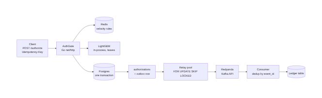

# AuthGate

**A Go card-authorization service whose transactional outbox lost 0 of 1,000,000 events across 9 broker outages and 8 relay kills.**

| | |
|---|---|
| **Problem** | A payment authorizer must approve or decline each card transaction exactly once and never lose the event that records it, even when the message broker or a worker crashes. |
| **What I built** | A Go HTTP service that decides each transaction with Redis velocity rules and an in-process LightGBM fraud model. It writes the balance hold, the decision and an outbox event in one Postgres transaction. A relay publishes the events to Redpanda and a consumer deduplicates them into a ledger. |
| **Result** | **0 lost events and 0 duplicates in the ledger** over 1,000,000 authorizations under fault injection; **p50 2.01 ms / p99 38.81 ms** at 1000 RPS on one shared host. |
| **Stack** | Go (net/http, pgx, go-redis, franz-go, leaves), PostgreSQL, Redis, Redpanda, LightGBM and scikit-learn (offline training), vegeta, Docker Compose, GitHub Actions |
| **Scope** | ~19 hours, solo project, October 2026 |

## Highlights
- Built a transactional outbox: decision and event commit together, so 1,000,000 authorizations produced 1,000,000 ledger rows and **0 lost events** ([chaos.json](results/chaos.json)).
- Survived fault injection of 9 broker outages (6 s each) and 8 relay SIGKILLs; the consumer absorbed 145 redelivered events, leaving **0 duplicates** ([chaos.json](results/chaos.json)).
- Held p50 between 2.01 ms and 2.84 ms from 200 to 3000 RPS with 100% success, with rules and the model enabled ([latency.md](results/latency.md)).
- Scored LightGBM in pure Go (no cgo, no ONNX); the Go/Python parity test uses 200 golden rows with a max-abs-diff limit of 1e-6 ([golden_scores.json](results/golden_scores.json)).
- Trained the fraud model on a time-ordered split and reported recall at fixed false-decline rates of 0.5%, 1% and 2% ([model_metrics.md](results/model_metrics.md)).

## Architecture


<sub>Diagram source: [docs/diagrams/architecture.mmd](docs/diagrams/architecture.mmd) (Mermaid)</sub>

A request checks the Redis counters (1 min and 1 h windows, plus an amount cap) and scores the transaction in-process. It then locks the account row, places the balance hold, and inserts the decision and the outbox row in a single Postgres transaction. The relay claims unsent rows with `SKIP LOCKED`, publishes with an idempotent producer, and marks a row sent only after the broker acknowledges. The consumer inserts into the ledger with `ON CONFLICT (event_id) DO NOTHING`.

## Results

### Chaos reconciliation
| metric | value |
|---|---|
| authorizations sent / ok / failed | 1,000,000 / 1,000,000 / 0 |
| broker outages (mode) | 9 (proxy_outage, 6 s each) |
| relay SIGKILLs | 8 |
| outbox rows / still unsent | 1,000,000 / 0 |
| consumer ledger rows | 1,000,000 |
| **lost events** | **0** |
| redelivered events (absorbed by dedup) | 145 |
| **duplicates in ledger** | **0** |
| negative balances | 0 |
| client throughput | 3859.1 RPS over 259.1 s |

Measured by `bench/chaos.sh`, which reconciles the `authorizations` table against the consumer ledger. Source: [results/chaos.json](results/chaos.json). Docker was unavailable in the build sandbox, so the "broker restarts" are outages injected by `cmd/chaosproxy` (all broker connections cut, new ones refused for 6 s), not process restarts of Redpanda.

### Latency
| target RPS | p50 ms | p99 ms | achieved RPS | success % |
|---|---|---|---|---|
| 200 | 2.4 | 6.53 | 200.0 | 100 |
| 500 | 2.2 | 64.34 | 500.0 | 100 |
| 1000 | 2.01 | 38.81 | 999.9 | 100 |
| 2000 | 2.39 | 87.87 | 1999.9 | 100 |
| 3000 | 2.84 | 153.86 | 2992.6 | 100 |

Measured with vegeta, 30 s per level, a unique Idempotency-Key per request. The load generator, AuthGate, Postgres and Redis share one host, which is why p99 grows with load while p50 stays flat. Sources: [results/latency.md](results/latency.md), [results/latency.json](results/latency.json).

### Fraud model
| false-decline rate | recall | achieved false-decline rate | threshold |
|---|---|---|---|
| 0.5% | 0.1270 | 0.0000 | 0.9722 |
| 1% | 0.1349 | 0.0091 | 0.9685 |
| 2% | 0.1746 | 0.0182 | 0.9619 |

LightGBM on FraudBench with a time-ordered split: the first 353 claims train, the last 236 test (126 fraud, 110 legit). Test AUC is 0.7766. Thresholds are chosen on the test legit scores. Sources: [results/model_metrics.md](results/model_metrics.md), [results/model_metrics.json](results/model_metrics.json), [results/golden_scores.json](results/golden_scores.json).

## Engineering decisions
- **Transactional outbox instead of publishing from the request path**: the event exists if and only if the decision committed, so a broker outage cannot lose or invent an event. The trade-off is at-least-once delivery, which needs deduplication downstream.
- **Dedup by `event_id` in the consumer**: a unique key on the ledger turns redeliveries into no-ops (145 absorbed in the chaos run). This gives effectively exactly-once effects; the transport itself is not exactly-once.
- **`SELECT ... FOR UPDATE` on the account row**: serializes concurrent holds so a balance cannot go negative (0 negative balances in the chaos run). The trade-off is per-account contention, accepted for correctness.
- **Idempotency-Key on `/authorize`**: a client retry returns the same decision and writes one row.
- **Pure-Go inference with `leaves`**: no cgo or ONNX runtime in the serving path, at the cost of a Go/Python parity test to prove the scores match.

## Run it
```bash
docker compose up -d                        # Postgres, Redis, Redpanda, AuthGate on :8080 (needs checkpoints/model.txt from train.py)
uv sync && uv run python train.py           # model, results/model_metrics.md, golden_scores.json
go test -race -count=1 ./...                # needs Postgres and REDIS_URL (see .github/workflows/ci.yml)
uv run pytest tests/test_acceptance.py -v   # acceptance checks
# Benchmarks need DATABASE_URL, REDIS_URL, KAFKA_BOOTSTRAP
bench/load.sh                               # ~5 min, writes results/latency.md
bench/chaos.sh                              # 1M authorizations, ~4-5 min of load here, writes results/chaos.json
```
With Docker, restart Redpanda for real in the chaos run: `BROKER_RESTART_CMD="docker compose restart redpanda" bench/chaos.sh`. `bench/dev-postgres.sh` starts a local Postgres where Docker is unavailable.

## Project structure
```
cmd/authgate/       service entrypoint (API, relay and consumer modes)
cmd/bombard/        load generator for the chaos run
cmd/chaosproxy/     broker outage injector
cmd/reconcile/      authorizations vs ledger reconciliation
internal/api/       POST /authorize handler
internal/store/     schema.sql and the single-transaction hold + decision + outbox write
internal/rules/     Redis velocity rules
internal/scorer/    pure-Go LightGBM scoring
internal/relay/     outbox relay (SKIP LOCKED, idempotent producer)
internal/consumer/  deduplicating consumer and ledger
bench/              load.sh, chaos.sh and helpers
train.py            offline LightGBM training and golden export
results/            all measured numbers (JSON, Markdown)
tests/              acceptance tests
```

## Limitations and next steps
- Chaos "broker restarts" are proxy-injected outages, not real Redpanda restarts; rerun with `BROKER_RESTART_CMD` where Docker is available.
- Load and chaos ran on one shared host, so p99 (up to 153.86 ms at 3000 RPS) includes contention with the load generator and databases.
- FraudBench is a small claim-fraud proxy dataset (589 rows), not card data. With 110 legit test rows, the 0.5% row means zero false declines and recall is low (0.1270 to 0.1746). The model demonstrates the serving path, not production accuracy.
- Next: a real card-transaction dataset, a separate load host, and multi-node broker failure tests.

## Author
**David Carciente**: MASc student, University of Waterloo ·
[LinkedIn](https://www.linkedin.com/in/david-carciente-334b42260/) ·
[GitHub](https://github.com/CarciDev) · [Website](https://www.davidcarciente.com/)
